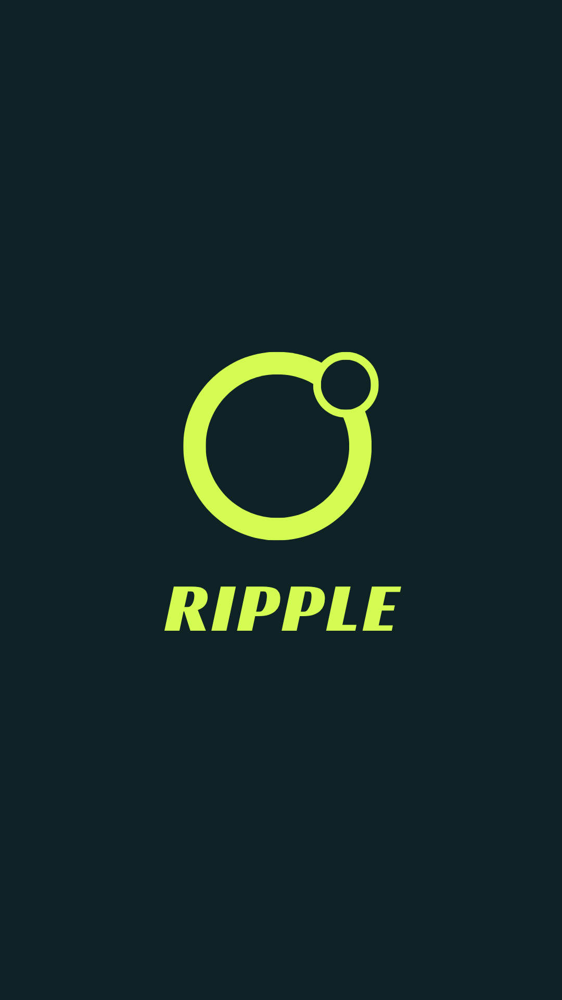

<p align="center">
  
</p>

<h1 align="center">Ripple</h1>

<p align="center"><b>Lovable for personal native apps.</b> Describe the app you want — open it on your phone, instantly, forever.</p>

<p align="center">
  
  
  
  
</p>

> Product vision, constraints, and agent rules live in [`PROJECT.md`](PROJECT.md) — the single source of truth.

---

No backends. No deployment. No passwords. No compilation anxiety. Think of Ripple as a **Paintbook**: the binding (runtime, storage, auth, sharing, gallery) is already provided — you only paint.

## ✨ What it does

| You say | Ripple does |
|---|---|
| *"Make a 3 goals daily planner"* | Generates the screen, saves it, opens it — done |
| *"A habit tracker for my mornings"* | AI-designed tracker in your gallery |
| *"Share my planner with mom"* | Private magic link, no account needed on her side |

- 🔐 **Passwordless sign-in** — email + 4-digit code, 10-minute expiry
- 🎨 **AI screen design** — Genkit + Gemini emit declarative UI against a fixed component catalog (never free-form code, so output always compiles)
- 📱 **Your Apps gallery** — every creation saved per-user, reopened anytime
- 💾 **Per-app data** — counters, toggles, notes persist across sessions
- 🔗 **Private sharing** — magic links with expiry and revocation
- 🌗 **Lime + olive theme** — light and dark, Oswald display + Roboto body

Personal apps only — no realtime, chat, or social features. Small and finished beats large and broken.

## 🚀 Quickstart

**Prerequisites:** Flutter SDK, Dart SDK, Docker Desktop (local database), Serverpod CLI (`dart pub global activate serverpod`).

```bash
# 1. Start everything (server, migrations, app)
serverpod start

# 2. Sign in instantly with the dev account
#    Email: test@ripple.ai   Code: 1234   (acts as Jane)

# 3. Try it: Home → "Make a 3 goals daily planner" → watch it open
```

**Enable real AI generation** (otherwise "Generate with AI" reports *not configured*):

1. Grab a free key at [aistudio.google.com](https://aistudio.google.com)
2. Add it under `development:` in `ripple_server/config/passwords.yaml` *(gitignored, never committed)*:
   ```yaml
   development:
     geminiApiKey: 'YOUR_KEY_HERE'
   ```
3. Restart the server (passwords load at boot)

## 🧠 How it works

```
You describe an app
        ↓
Genkit + Gemini output declarative UI JSON (fixed catalog only)
        ↓
Server validates the contract, stores it as a Serverpod model
        ↓
Flutter host renders real native widgets (UiRenderer)
        ↓
Values persist per user + app · gallery · magic links — all Serverpod
```

The agent can never break compilation: it emits JSON against 13 fixed components, and the server rejects anything off-contract (with one repair retry).

## 🗂️ Structure

```
ripple/
├── PROJECT.md                  # Vision, PRD, architecture, agent rules
├── TODO.md                     # Living task list
├── HANDOFF.md                  # State + next steps
├── assets/                     # Brand source art (splash, icon)
├── ripple_server/              # Backend: auth, gallery, data, sharing, Genkit
│   └── lib/src/
│       ├── apps/               # AppDefinition, AppData, MagicLink + endpoints
│       ├── auth/               # OTP passwordless sign-in
│       └── generate/           # Genkit UI generation + catalog contract
├── ripple_client/              # Generated client — do not edit
└── ripple_flutter/             # Host app
    └── lib/
        ├── ui_engine/          # Declarative renderer + component catalog
        ├── shell/              # App shell, drawer, top bar
        ├── features/           # home, explore, gallery, builder, runner, …
        ├── services/           # Thin wrappers over the generated client
        └── theme/              # Lime/olive tokens, fonts
```

## 🛠️ Workflow

- Codegen is automatic under `serverpod start`; manual fallback is `serverpod generate` in `ripple_server/`.
- Model changes need a migration (`serverpod create-migration`, applied on boot).
- After changes: `dart analyze` → `dart format` → `dart test` (server) → check logs.
- Never edit generated code (`lib/src/generated/`, `ripple_client/`).
- Never start the server from an agent session — ask the user to run it.

## 🏆 Hackathon context

Built for Serverpod's **Build Something Real** hackathon. Judging: does it work (30%), Serverpod stack use (25%), craft (25%), usefulness (20%). The core loop — *describe → generate → save → reopen → data persists* — works end to end today.
